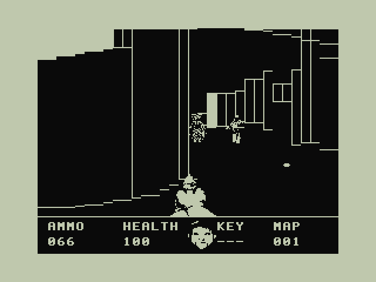
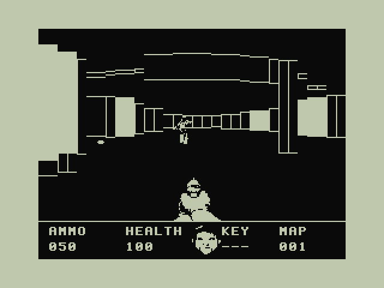
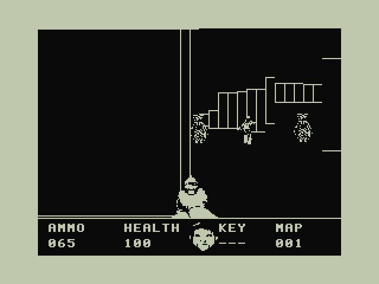
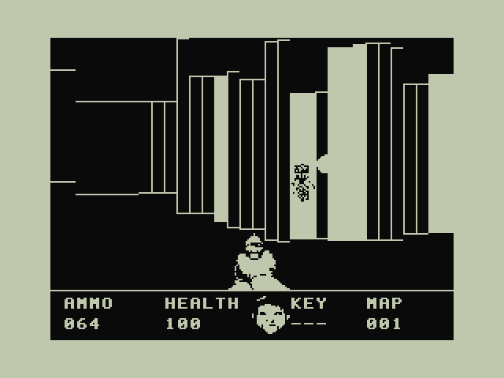
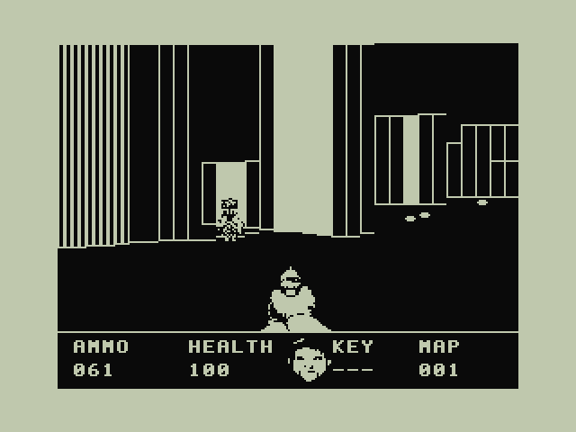

# WYRMFIRE

A first-person game for the **Dragon 64** (stock 6809 at stock speed, 64 KB,
PAL) with a **DragonDOS disk controller**. It is not a Tandy CoCo program and
does not run on one. It has been tested only in the
[CLOADM](https://github.com/yaniv-golan/CLOADM) emulator; real hardware is
untested.

## Play it

    node converter/cli.mjs freedoom1.wad --map E1M1 --out wyrmfire.vdk   # Freedoom 0.13.0 (BSD-3-Clause)
    # CLOADM: Dragon 64, 64 KB, PAL, Dragon (DragonDOS) controller, wyrmfire.vdk in drive 0
    # load bin/wyrmfire.bin as a binary program and keep the disk mounted

No level disk is shipped: you build it from a WAD with the converter, as
above. `freedoom1.wad` is in the [Freedoom 0.13.0](https://freedoom.github.io)
zip. For Freedoom E1M1 (and only that map) the result must have the
SHA-256 pinned in [`release/expected.json`](release/expected.json).



| | |
|---|---|
|  |  |
|  |  |

*Recorded headless in CLOADM (Dragon 64, PAL, no ROMs) from the Freedoom
E1M1 level disk. The level data is converted from [Freedoom](https://freedoom.github.io)
0.13.0, Copyright © 2001-2024 Contributors to the Freedoom project, used under
the BSD 3-Clause licence (full text: [third_party/freedoom/COPYING.adoc](third_party/freedoom/COPYING.adoc)),
and has been modified for the Dragon 64. The Freedoom project does not endorse
CLOADM or WYRMFIRE. The GIF plays at the emulated machine's real frame rate.
To regenerate: [README media](#readme-media).*

## Running

In [CLOADM](https://github.com/yaniv-golan/CLOADM): Dragon 64, 64 KB, PAL;
attach a Dragon (DragonDOS) disk controller, mount the level `.vdk` in drive 0,
then load `wyrmfire.bin` as a binary program. Keep the disk mounted: assets load
before the title cue and regions stream during play. Real hardware would need a
Dragon 64 with a WD2797 DragonDOS-compatible controller and an 80-track
double-sided drive; this is untested.

| Keys | Action |
|---|---|
| Up / Down | Move | 
| Left / Right | Turn |
| Z / X | Strafe |
| Space | Fire or punch |
| E | Open a door / use the exit |
| 1 / 2 / 3 | Fist / pistol / shotgun |
| D | Toggle wall hatching |
| Enter | Skip a cue; restart after death or exit |
| C (on the title) | Credits: the level disk's credit, then the engine's; Enter continues |

## Making a level disk

Browser or Node, no dependencies:

```js
import { convert } from './converter/wyrmfire-convert.js';
const { disk, info } = convert(wadBytes, { map: 'E1M1' }); // disk: the .vdk bytes
```

The input can be a bare `.wad`, a `.zip`, an `.lzh`/`.lha`, or a
self-extractor and its split parts (pass several files as
`[{ name, bytes }, ...]`), e.g. the original shareware download as is
([docs/FORMATS.md](docs/FORMATS.md#converter-inputs)). In a page, run it off
the main thread with `converter/worker.js`
(`postMessage({ id, wad: arrayBuffer, map })` or `{ id, files: [{ name, bytes }], map }`).
From a shell:

    node converter/cli.mjs freedoom1.wad --map E1M1 --out wyrmfire.vdk --info info.json
    node converter/cli.mjs DOOMS_19.1 DOOMS_19.2 --list
    node converter/cli.mjs doom19s.zip --map E1M1 --sha256 <pin> --out e1m1.vdk   # your own copy; never commit the output

Any map of a Doom-format IWAD can be named (`E1M1`, `MAP01`, ...); Doom
II-format IWADs are not supported yet (their music lumps differ, see
[docs/FREEDOOM-FIT.md](docs/FREEDOOM-FIT.md#known-limit-doom-ii-format-iwads)). The
converter is deterministic. A map that exceeds a level-pack limit fails with a
`LimitError` that names the limit; nothing is silently cropped (see
[docs/FREEDOOM-FIT.md](docs/FREEDOOM-FIT.md)). The disk holds `WYRMFIRE.DAT`
(HGA1 assets, sector 0) and `WYRMFIRE.LVL` (HGR2 level pack, header at
sector 30, regions after it, skipping the directory tracks) and, on a Freedoom
disk, `CREDITS.TXT` (the credit, a note that the data is modified and
Freedoom's licence) when it fits.
Formats: [docs/FORMATS.md](docs/FORMATS.md).

## How it works

The engine is written in C for the 6809 (CMOC + LWTOOLS). The engine binary
holds only code, an engine-owned font and math tables; every level, sprite,
sound and music cue is read from a **level disk**. Level disks are made by a
converter that loads Doom-format WADs and runs in the browser (a Web Worker)
or in Node.

## Layout

| Path | What |
|---|---|
| `src/` | Engine: `native.c`, renderer (`scene.h`), combat (`combat.h`), WD2797 driver (`floppy.h`), field-sync level clock (`clock.h`), level-disk layout and RAM map (`disk.h`), engine-owned `font.h` and `tables.h`, self-extracting loader (`loader.asm`) |
| `bin/wyrmfire.bin` | The committed engine binary; CI rebuilds it and requires a byte-identical match |
| `converter/` | `wyrmfire-convert.js` (dependency-free ES module), `worker.js` (Web Worker), `cli.mjs` |
| `tools/reference/` | Python reference converter; the JS output must equal it byte for byte |
| `tools/` | `build-engine.sh`, `pack.py` (engine packer), `mkfont.mjs`, `fit-report.mjs`, `make-release.mjs`, `readme-media.cjs` (README media), pinned `versions.env` |
| `test/` | Converter unit tests, JS/Python parity, CLOADM smoke test, emulator harnesses (`test/harness/`) |
| `docs/` | Formats, RAM map and the Freedoom fit report; `docs/media/` holds the README screenshots and GIF (Freedoom E1M1) |

## Building the engine

Needs exactly the versions pinned in [`tools/versions.env`](tools/versions.env)
(CMOC 0.1.101, LWTOOLS 4.25) and Python 3 (standard library only):

    tools/build-engine.sh build          # -> build/wyrmfire.bin, build/engine.map
    cmp build/wyrmfire.bin bin/wyrmfire.bin

The CI workflow installs those versions from their official release tarballs,
verifies their SHA-256, builds, and fails if the result differs from
`bin/wyrmfire.bin`.

## Tests

    node --test test/converter.test.mjs                       # unit tests (synthetic WADs)
    sh test/fixtures/make-archives.sh freedoom1.wad /tmp/fx   # needs lhasa + jlha-utils
    ARCHIVE_FIXTURES=/tmp/fx node --test test/archive.test.mjs test/mutation.test.mjs
    FREEDOOM1=freedoom1.wad node --test test/converter.test.mjs
    PARITY_WADS=freedoom1.wad:freedoom2.wad node --test test/parity.test.mjs   # needs numpy
    CLOADM=../CLOADM WYRMFIRE_BUILD=build node --test test/smoke.test.mjs      # build/ holds wyrmfire.bin + wyrmfire.vdk

CLOADM is a development dependency only: CI clones it at a pinned commit
(`CLOADM_COMMIT` in `.github/workflows/ci.yml`) and uses its public Node API
(`js/emu.js`, `cli/cloadm.js`). To do the same locally:

    git init -q cloadm && git -C cloadm fetch -q --depth 1 https://github.com/yaniv-golan/CLOADM.git <CLOADM_COMMIT>
    git -C cloadm checkout -q FETCH_HEAD

## Emulator harnesses

Each harness takes the CLOADM checkout and a directory holding a level disk
named `wyrmfire.vdk`. The engine comes from the committed `bin/wyrmfire.bin`
and its symbol list `bin/wyrmfire.sym`, so **CMOC and LWTOOLS are needed only
to rebuild the engine**; if the directory also holds `wyrmfire.bin` and
`engine.map` from `tools/build-engine.sh`, those are used instead.

    mkdir run
    node converter/cli.mjs freedoom1.wad --map E1M1 --out run/wyrmfire.vdk   # or your own WAD / doom19s.zip
    CLOADM=$PWD/cloadm WYRMFIRE_BUILD=run node --test test/smoke.test.mjs     # boots, waits for the first in-game frame
    node test/harness/regions.cjs cloadm run run/regions.json                 # stall of every disk region
    node test/harness/encounter.cjs cloadm run                                # imp attack, dodge, shotgun spread
    node test/harness/sprites.cjs cloadm run                                  # monster feet, size, screen edge, occlusion (PNGs in run/sprites/)
    node test/harness/identity.cjs cloadm run run/pictures.txt                # a hash of every picture of a scripted run; must match test/identity.sha256
    ONE_LEVEL=1 node test/harness/route.cjs cloadm run                        # walks from the spawn to the exit
    node test/harness/swap.cjs cloadm run                                     # same binary, replacement level disk
    node test/harness/profile.cjs cloadm run run/shots                        # per-function time profile + PNGs
    node tools/cycles-per-picture.mjs cloadm run                              # CPU cycles per picture, to the instruction (--keys LEFT: a turning view)
    node tools/profile-cycles.mjs cloadm run                                  # the same window, cycles per function (self and inclusive)
    node test/harness/clock.cjs cloadm run                                    # level clock counts every field, loads included
    node test/harness/end-screen.cjs cloadm run                               # TIME mm:ss and KILLS on the level clear
    sh test/clock-mutants.sh cloadm run/wyrmfire.vdk                          # clock mutants must fail (needs CMOC + LWTOOLS)
    node test/harness/credits.cjs cloadm run                                  # credits screen (Freedoom disk) and its mutant

Level disks converted from id Software WADs stay on your machine: never
commit or upload them.

## README media

The screenshots and the GIF in [`docs/media/`](docs/media) are recorded by
[`tools/readme-media.cjs`](tools/readme-media.cjs), headless in CLOADM at the
`CLOADM_COMMIT` pinned in `.github/workflows/ci.yml`, on CLOADM's built-in
firmware (no BASIC or DOS ROM), with the committed `bin/wyrmfire.bin`:

    node tools/readme-media.cjs cloadm freedoom1.wad          # -> docs/media/*.png, docs/media/gameplay.gif

It accepts only the pinned Freedoom 0.13.0 `freedoom1.wad` (SHA-256 in
[`tools/versions.env`](tools/versions.env)) and requires the converted E1M1
disk to match [`release/expected.json`](release/expected.json); the disk lives
in a temporary directory and is deleted afterwards. The player is driven by
the same grid autopilot as the route harness, and time is counted in emulated
PAL fields, so a rerun gives byte-identical files (it prints their SHA-256).
The shots are taken at fixed picture numbers and the GIF covers 7.9 s from a
fixed picture (`SHOTS`, `GIF_FROM` and `GIF_SECONDS` at the top of the
script); after an engine change, check the pictures still show what their alt
text says.

## Releases

`.github/workflows/release.yml` (manual or on a `v*` tag) builds the engine,
runs the converter tests and attaches the engine, its SHA-256, the symbols,
the converter and a `manifest.json` to a **draft** release; no level disk or
WAD-derived file is ever attached. CI's *Release dry run* job does the same
without publishing. Nothing has been released yet. See
[docs/RELEASE.md](docs/RELEASE.md) (assets, versioning, what CLOADM pins).

## No id Software content

This repository and its releases contain **no id Software data**: no WAD, and
nothing converted from one (sprites, textures, levels, music, sounds, disk
images, binaries built from them, screenshots or videos). The engine binary
contains no WAD-derived data at all; CI checks that it builds byte-identically
from source alone.

- To play id's levels, convert your own legally obtained WAD (for example a
  `DOOM1.WAD` you own) locally. Never commit or upload the result.
- No level disk is committed or released, Freedoom's included. The reference
  level disk is converted from [Freedoom](https://freedoom.github.io)
  (BSD-3-Clause) E1M1, which CI downloads at a pinned SHA-256, converts and
  checks against `release/expected.json`; it is kept only as a CI artifact.
  See [CREDITS.md](CREDITS.md) and [LICENSES/freedoom.txt](LICENSES/freedoom.txt).
- Tests run on Freedoom only. No id WAD is used in CI.
- Contributing: never commit a commercial WAD or anything converted from one
  ([CONTRIBUTING.md](CONTRIBUTING.md)).

## Licence

WYRMFIRE is GPL-3.0-or-later ([LICENSE](LICENSE)).

WYRMFIRE level data is converted from Freedoom (https://freedoom.github.io), Copyright © 2001-2024 Contributors to the Freedoom project, used under the BSD 3-Clause licence (full text: third_party/freedoom/COPYING.adoc). The data has been modified for the Dragon 64. The Freedoom project does not endorse CLOADM or WYRMFIRE.

DOOM is a registered trademark of ZeniMax Media Inc. CLOADM and WYRMFIRE are independent projects, not affiliated with or endorsed by id Software, ZeniMax Media or Microsoft. References to DOOM describe file compatibility only.

Freedoom's licence, credits and version note are in
[`third_party/freedoom/`](third_party/freedoom). See also [CREDITS.md](CREDITS.md).
